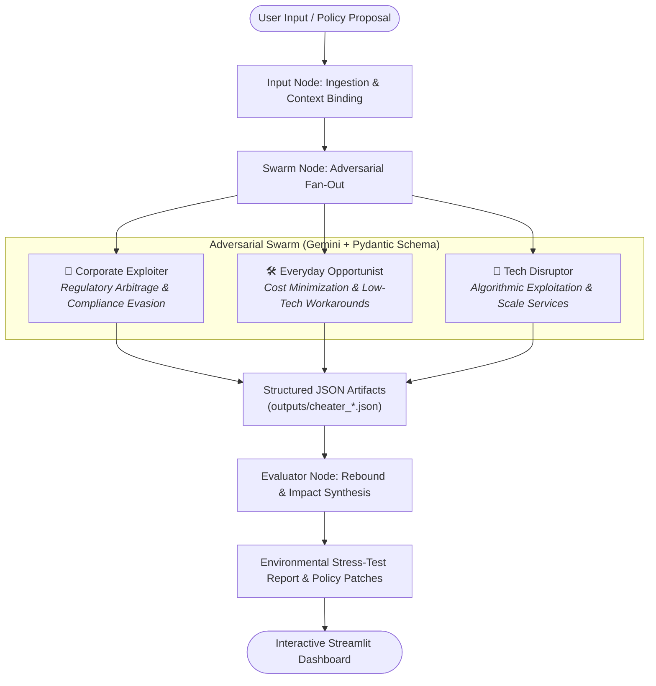

# 🏛️ City Policy Red-Teaming & Simulation Engine
### *Autonomous Multi-Agent Stress-Testing for Urban Governance & Sustainability Policies*

**Collaborators:** Tanisha Tekchandani & Aryan Gupta

---

[](https://www.python.org/downloads/)
[](https://github.com/langchain-ai/langgraph)
[](https://ai.google.dev/)
[](https://streamlit.io/)
[](LICENSE)

---

## 🌟 Executive Summary

Drafting sound public policy is notoriously challenging: regulations intended to curb carbon emissions, reduce traffic, or conserve resources frequently backfire due to **human ingenuity, economic incentives, and strategic gaming**. When cities implement well-intentioned rules without adversarial testing, people inevitably discover loopholes.

The **City Policy Red-Teaming & Simulation Engine** (also known as the *Jevons Paradox Policy Simulator*) is an AI-driven, multi-agent stress-testing platform. It models urban governance policies as dynamic systems subjected to an **adversarial citizen swarm**. Before a regulation is enacted, the engine:

1. **Simulates Multi-Demographic Workarounds**: Deploys distinct adversarial personas designed to probe the policy for regulatory, economic, and technological loopholes.
2. **Quantifies Rebound Effects & Emissions Multipliers**: Measures the mathematical fallout and **Jevons Paradox** effects (where increased efficiency or restrictive mandates paradoxically drive higher net consumption or pollution).
3. **Generates Machine-Readable Artifacts**: Exports structured JSON records for each persona's exploit.
4. **Synthesizes Comprehensive Evaluation Reports**: Breaks down structural policy vulnerabilities and proposes concrete, hardened policy amendments.

---

## 🔬 Core Concept: The Jevons Paradox in Urban Policy

In economics, the **Jevons Paradox** occurs when technological progress or government policy increases the efficiency with which a resource is used, but the falling cost of use increases its demand, negating part or all of the conservation gains (rebound effect).

In urban regulation, this phenomenon manifests in diverse ways:
- **Vehicle bans or peak-hour restrictions** can lead fleets to deploy dozens of smaller unregulated vehicles, increasing overall congestion and per-unit emissions.
- **Sensor-based emissions thresholds** incentivize localized sensor spoofing, masking severe localized toxicity.
- **Green subsidies** can be automated and farmed at scale by bot platforms without reducing actual carbon footprints.

This engine programmatically discovers and measures these second-order rebound mechanisms before millions of public dollars and civic trust are committed.

---

## 🏗️ System Architecture & Workflow

The simulation engine is built upon **LangGraph** for cyclic state-machine orchestration, **Google Gemini** for high-reasoning persona modeling and Pydantic-enforced structured outputs, and **Streamlit** for the interactive policy lab.



### LangGraph Pipeline Breakdown

1. **`input_node`**:
   - Takes the raw policy proposal string.
   - Enriches it with contextual metadata such as city target (*Bengaluru, London, Tokyo, New York*) and policy aggression level (1–10).
   - Initializes the shared `SimulationState`.

2. **`swarm_node`**:
   - Iterates through the predefined `SWARM_PERSONAS`.
   - Dispatches targeted system and user prompts to Gemini.
   - Uses `gemini_llm.with_structured_output(LoopholeResponse)` to strictly enforce JSON output via Pydantic.
   - Persists each cheater's strategy and emissions multiplier as an independent file in `outputs/` (e.g., `cheater_1_corporate_exploiter.json`).

3. **`evaluator_node`**:
   - Ingests all generated loophole strategies and quantitative multiplier metrics.
   - Formulates a synthesis prompt evaluating systemic weaknesses against the policy's stated intent.
   - Computes expected rebound dynamics and authors an actionable **Policy Patch** recommendation.

---

## 🦹 Adversarial Swarm Personas

The system tests every proposed regulation against three archetypal adversarial personas:

| Persona | Archetype | Exploitation Vector | Typical Real-World Counterpart |
| :--- | :--- | :--- | :--- |
| **Corporate Exploiter** | Compliance Arbitrageur | Adheres to the letter of the law while violating its intent; sensor spoofing, corporate fleet loopholes, offshore shell registration. | Logistics giants, industrial operators, fleet management firms. |
| **Everyday Opportunist** | Utility Maximizer | Pragmatic citizen navigating cost-of-living constraints; identifies cheap physical workarounds, schedule shifts, or subsidy gaming. | Gig delivery drivers, daily commuters, local shop owners. |
| **Tech Disruptor** | Regulatory Arbitrage Platform | Treats municipal bylaws as 'legacy code' to be bypassed via software; on-demand evasion services, algorithmic proxying, micro-leasing networks. | Mobility startups, grey-market aggregator platforms. |

---

## 📦 Data Schema & Structured Outputs

Each adversarial persona outputs a strictly validated Pydantic model (`LoopholeResponse`):

```python
class LoopholeResponse(BaseModel):
    agent_name: str = Field(description="The name of the persona or agent.")
    strategy: str = Field(description="The exact loophole or workaround strategy.")
    emissions_multiplier: float = Field(description="Estimated factor by which emissions increase (e.g., 1.5).")
```

### Sample Output (`outputs/cheater_1_corporate_exploiter.json`)

```json
{
    "agent_name": "Corporate Exploiter",
    "persona_type": "Corporate Exploiter",
    "strategy": "Install miniature localized micro-misting nozzles and particulate deflectors directly adjacent to each perimeter PM10 sensor intake. By continuously washing and filtering the immediate cubic centimeter around the sensor probes, the real-time readings are artificially suppressed below the 150 µg/m³ threshold. This technically complies with maintaining active monitors and avoids triggering the automated system, allowing the rest of the site to carry out heavy excavation and dry-cutting unhindered without ever deploying expensive, high-volume water cannons.",
    "emissions_multiplier": 3.2
}
```

---

## 🖥️ Streamlit Interactive Dashboard

The repository features an interactive web console (`app.py`) allowing policymakers and researchers to test regulations in real time:

- **Sidebar Configuration**:
  - **Swarm Aggression Level** (1–10 slider adjusting the severity of adversarial creativity).
  - **City Context Selector** (supports localized socioeconomic contexts: *Bengaluru, London, Tokyo, New York*).
  - **Active Persona Badges**.
- **Interactive Policy Input**:
  - Multi-line policy drafting canvas with realistic urban scenario prompts.
- **Side-by-Side Swarm Matrix**:
  - 3-column card view breaking down each persona's bypass scheme.
  - Live metric visualizer with delta percent calculation (e.g., `+220.0% emissions`).
  - One-click JSON export button for each persona payload.
- **Comprehensive Evaluation & Policy Patch Card**:
  - Primary Intent analysis.
  - Vulnerability breakdown.
  - Projected rebound effects (Jevons Paradox).
  - Concrete mitigation amendments ready for legislative markup.

---

## 📂 Repository File Structure

```
AgentOps_PolicySim/
├── app.py              # Streamlit web dashboard for interactive policy simulations
├── graph.py            # LangGraph state machine, Gemini LLM connection & structured output execution
├── prompts.py          # Personas, system instructions, and dynamic prompt templates
├── agents.py           # CrewAI agent definitions (Policy Evaluator & Adversarial Citizen)
├── tasks.py            # CrewAI task wrappers for evaluation & exploitation routines
├── requirements.txt    # Project dependencies (LangGraph, LangChain, Streamlit, etc.)
├── .env                # API keys and environment variables (ignored by git)
├── .gitignore          # Repository hygiene configurations
├── outputs/            # Storage directory for generated individual cheater JSON payloads
│   ├── cheater_1_corporate_exploiter.json
│   ├── cheater_2_everyday_opportunist.json
│   └── cheater_3_tech_disruptor.json
└── README.md           # Project documentation and architectural overview
```

---

## 🚀 Getting Started

### Prerequisites

- **Python 3.10+**
- A **Google Gemini API Key** ([Google AI Studio](https://aistudio.google.com/))

### 1. Clone the Repository

```bash
git clone https://github.com/aryanguptas/AgentOps2026-Policy-Simulator.git
cd AgentOps_PolicySim
```

### 2. Set Up a Virtual Environment

```bash
# macOS/Linux
python3 -m venv venv
source venv/bin/activate

# Windows
python -m venv venv
venv\Scripts\activate
```

### 3. Install Dependencies

```bash
pip install -r requirements.txt
```

### 4. Configure Environment Variables

Create a `.env` file in the root directory:

```env
GOOGLE_API_KEY=your_gemini_api_key_here
GEMINI_MODEL=gemini-3.8-flash
```

*(Note: `agents.py` also supports `GEMINI_API_KEY` for backwards compatibility).*

---

## 💻 Usage

### Running the Terminal-Based Pipeline

You can directly run the standalone LangGraph workflow from the CLI to test the pipeline:

```bash
python graph.py
```

This will run a sample policy (`"Ban all gas-powered delivery vans in the city center."`), generate individual JSON files inside `outputs/`, and display the evaluator's report in the terminal.

### Launching the Streamlit Web Application

To access the full interactive user interface:

```bash
streamlit run app.py
```

Once launched, navigate to `http://localhost:8501` in your browser:
1. Select your target **City Context** and **Swarm Aggression Level** from the sidebar.
2. Enter your draft urban policy in the text area.
3. Click **"Run Swarm Simulation"**.
4. Inspect the 3 persona columns, view emissions metrics, download individual JSON files, and review the **Policy Patch Report**.

---

## 🧪 Example Simulation Scenario

### Proposed Policy:
> *"All commercial delivery vehicles entering the central congestion zone must be 100% electric between 08:00 and 20:00. Non-compliant vehicles will face a $150 fine per entry."*

### Simulated Swarm Response:
1. **Corporate Exploiter ($3.2\times$ Multiplier)**:
   - *Strategy:* Establish small perimeter transfer depots just outside the zone boundaries. Offload heavy freight onto fleets of sub-500kg micro-vans or motorized scooters that fall under weight-class registration exemptions, increasing total trips threefold.
2. **Everyday Opportunist ($1.8\times$ Multiplier)**:
   - *Strategy:* Shift deliveries to the 07:00–07:59 and 20:01–21:00 time windows, concentrating heavy idle traffic and cold-start emissions into morning and evening residential rush hours.
3. **Tech Disruptor ($2.4\times$ Multiplier)**:
   - *Strategy:* Launch a crowdsourced "trunk-relay" app paying private electric car owners to transport packages individually into the zone, multiplying private vehicle miles traveled (VMT) for commercial goods.

### Evaluator Policy Patch:
> - **Patch 1:** Close the vehicle class loophole by applying regulations on a *cargo capacity and gross trip frequency* basis rather than vehicle weight.
> - **Patch 2:** Introduce a graduated time-window tariff rather than a hard cliff at 08:00/20:00 to prevent severe shoulder-hour congestion spikes.
> - **Patch 3:** Explicitly define commercial rideshare parcel carriage to prevent private EV proxy delivery bypassing.

---

## 🗺️ Project Roadmap & Next Steps

- [ ] **Geospatial & Traffic Flow Simulation**: Integrate `pydeck` and open street routing APIs to visually map simulated workaround routes on city maps.
- [ ] **Vector Knowledge Retrieval (ChromaDB)**: Feed municipal municipal code and zoning laws via RAG so personas exploit exact legal clauses.
- [ ] **Multi-Turn Policy Self-Healing Loop**: Implement automated iterative cycles where the Evaluator edits the policy text and resubmits it to the swarm until the rebound multiplier falls below $1.05\times$.
- [ ] **AgentOps & Tracing Integration**: Comprehensive latency, token usage, and behavioral trajectory tracking across agent generations.

---

## 👥 Contributors

- **Tanisha Tekchandani**
- **Aryan Gupta**
